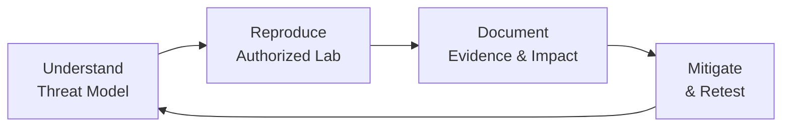

<div align="center">


<a href="https://github.com/teguhsibersec">
  
</a>

<br/>

[](https://github.com/teguhsibersec)
[](https://www.linkedin.com/in/teguh-priono-aa1466304/)
[](https://www.instagram.com/teguhsibersec/)


</div>

---

```text
┌──(teguhsibersec㉿kali)-[~]
└─$ whoami
Computer Science Student | Cybersecurity Enthusiast

┌──(teguhsibersec㉿kali)-[~]
└─$ cat mission.txt
Learn how systems break, so I can help build systems that don't.
```

## 👤 About

I'm **Teguh**, a Computer Science student building practical, hands-on skills in cybersecurity. I enjoy understanding how web applications work, how their weaknesses appear, and how to document and fix them clearly.

| | |
|---|---|
| 🎯 **Focus** | Web penetration testing, reconnaissance, OSINT, web security |
| 🧪 **Practice** | CTF challenges, intentionally vulnerable labs, authorized testing |
| 📚 **Learning** | Web vulnerabilities, Python scripting, security methodology |
| 🚀 **Goal** | Grow into a capable cybersecurity professional and make digital systems safer |

> *Good security starts with curiosity, careful testing, clear documentation, and responsible disclosure.*

## 🛠️ Tech & Toolkit

<div align="center">


</div>

| Area | Tools |
|---|---|
| **Web Testing** |  |
| **Recon & Scanning** |   |
| **Traffic Analysis** |  |
| **Environment** |   |
| **Scripting** |   |

## 📂 Projects

| Project | Description | Status |
|---|---|---|
| 🧪 **Web Security Labs** | Notes and write-ups from legal practice environments |  |
| 🔎 **Recon & OSINT** | Structured workflows for collecting and validating public information |  |
| 📓 **Cybersecurity Learning Notes** | Concise explanations, checklists, and lessons learned |  |
| 🛣️ **Smart Road Guard** | Computer-vision pothole detection with a data dashboard |  |

> 🔗 Repository links will be added as each project is published and documented.

## 🔬 Methodology

<div align="center">



</div>

1. **Understand** the concept and threat model.
2. **Reproduce** it in a controlled, authorized lab.
3. **Record** the evidence and explain the impact.
4. **Mitigate** with practical fixes, then retest.

## 📊 GitHub Stats

<div align="center">


</div>

## 🧭 Principles

- **Stay curious.** Keep asking why a system behaves the way it does.
- **Practice responsibly.** Test only systems I own or have explicit permission to assess.
- **Document clearly.** Make findings useful to developers, defenders, and other learners.
- **Keep improving.** Small, consistent labs beat occasional bursts of activity.

> ⚠️ **Disclaimer:** All content in my repositories is for educational purposes and authorized testing only. I do not condone unauthorized access to any system.

## 🤝 Let's Connect

I'm open to discussing cybersecurity, learning resources, CTF teams, and collaboration on learning projects.

<div align="center">

[](https://www.linkedin.com/in/teguh-priono-aa1466304/)
[](https://github.com/teguhsibersec)
[](https://www.instagram.com/teguhsibersec/)

<br/>

### `Access granted: keep learning. Stay ethical. Build better security.`


</div>
